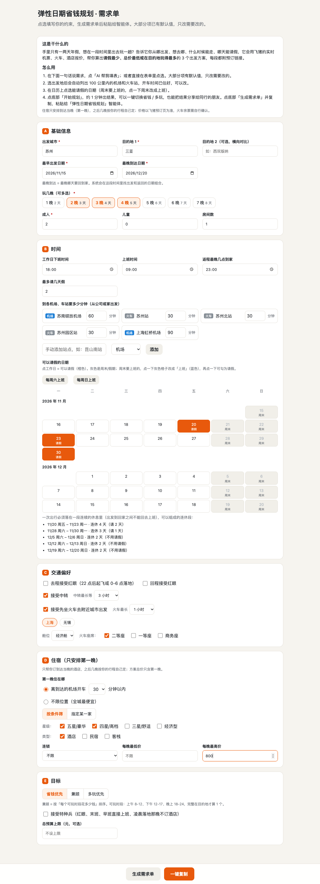
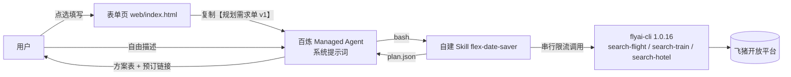

# 弹性日期省钱规划 · flex-date-saver

> 2026 飞猪 AI 旅行创新大赛参赛作品｜百炼 Managed Agent ＋ 飞猪 FlyAI Skill ＋ 自建 Skill ＋ 静态表单页

「我有 1 天年假，11 到 12 月想去三亚，哪几天出发请假最少、总价最低？」
在表单里点选你的约束：几点下班、到机场多久、哪天能请假、接不接受红眼、接不接受中转、能不能先坐动车去附近城市。智能体会用飞猪的真实机票、火车、酒店报价，算出前 3 个出发方案。每个方案都给出总价拆分、能在目的地玩几个完整时段、要请几天假、有哪些风险，以及每一段的预订链接。



## 为什么需要它

- 拼假、错峰省钱是刚需，但要在「请假 × 日期 × 交通 × 酒店」之间来回比价十几次。
- 飞猪 AI 搜索遇到这类问题会直接回复「无法完成」（实测：问「10/20–11/10 上海去三亚 3 晚，算出往返机票加五星酒店总价最低的出发日期」）。
- 飞猪分品类接口其实能拿到逐日机票价和逐日酒店起价，缺的是把多次查询编排起来、按个人约束过滤、再做计算和取舍的一层。本作品补的就是这一层。

## 核心亮点

1. **个人约束精确建模**：下班时间 + 到各站通勤 + 安检缓冲推出最早可坐的航班；可请假日期用日历勾选；返程按最晚到家时间倒推；红眼、中转等待时长、邻近城市「火车 + 换乘 + 航班」衔接都按规则校验。
2. **「完整时段」计量多玩**：上午 8–12、下午 12–17、晚上 18–24，完整落在「落地 + 60 分钟」到「返程起飞 − 120 分钟」之间才算 1 个。
3. **特种兵模式**：放开红眼、末班、早班直接上班，凌晨 2 点后落地那晚不订酒店。
4. **每个数字都可验证**：价格、时段、请假天数全部由脚本根据飞猪真实返回计算，同一输入结果完全一致；每段都附飞猪预订链接。
5. **一句话切换目标**：省钱优先 / 多玩优先 / 兼顾（每个时段花多少钱），重排秒级完成，不重新查价。
6. **会解释「为什么没方案」**：比如「下班后出发的日期都赶不上 22 点前起飞的航班，接受去程红眼可解锁」。

## 架构



脚本流水线：`validate_request` 校验补默认 → `plan_candidates` 节假日与请假计算、生成候选日期 → `fetch_quotes` 串行查价与过滤 → `score_rank` 总价、时段、排序。总入口 `run_plan.py`。

## 目录

```
├── skill/flex-date-saver/      # 自建 Skill（整个目录打包上传百炼）
│   ├── SKILL.md
│   ├── scripts/                # validate_request / plan_candidates / fetch_quotes / score_rank / run_plan
│   └── config/                 # 默认值、节假日、换乘估算、邻近枢纽、连锁品牌词表
├── prompts/system_prompt.md    # 智能体系统提示词
├── web/index.html              # 表单页（GitHub Pages）
├── tests/                      # 单元测试 + 真实接口录制数据 + 样例需求单
├── docs/api-notes.md           # 飞猪接口实测结论
├── docs/demo-cache/            # 演示回放数据（真实录制）
└── tools/                      # 接口核验、录制、部署脚本
```

## 部署到百炼 Managed Agent

1. **运行环境**：预装 npm 包 `@fly-ai/flyai-cli@1.0.16`，网络策略 `unrestricted`（只能通过 API 设置，见 `tools/deploy_bailian.py`）。
2. **Skill**：把 `skill/flex-date-saver/` 和飞猪官方 Skill 分别打成 zip（根目录是 SKILL.md）上传，审核通过后挂载到智能体。
3. **系统提示词**：`prompts/system_prompt.md`，把 `{{FORM_URL}}` 换成表单页地址。
4. **飞猪 Key**：用会话环境变量 `FLYAI_API_KEY`，**不要用密钥库**（实测会 401）。Key 读不到时 CLI 会静默进入「体验模式」，结果里出现这几个字就说明没生效。

## 本地运行

```bash
npm i -g @fly-ai/flyai-cli@1.0.16
flyai config set FLYAI_API_KEY "你的Key"
cd skill/flex-date-saver
python3 scripts/run_plan.py --request ../../tests/requests/sample_suzhou_sanya.json --out /tmp/plan.json --workdir /tmp/fds_run
# 只改目标、不重新查价
python3 scripts/score_rank.py --request /tmp/fds_run/request.normalized.json --quotes /tmp/fds_run/quotes.json --out /tmp/plan.json --goal play
# 不联网回放演示数据
python3 scripts/run_plan.py --request ../../tests/requests/sample_suzhou_sanya.json --out /tmp/plan.json --workdir /tmp/fds_demo --cache-dir ../../docs/demo-cache/flyai --replay
# 测试
cd ../.. && python3 -m unittest discover -s tests -v
```

## 数据边界（照实说明）

- 火车接口不返回余票，所有火车段都标「余票需自行确认」；座席参数不生效，脚本按返回的座席过滤。
- 酒店价格是每晚参考起价，不是具体房型；关键词区域筛选不生效，行政区用目的地参数、商圈靠名称地址过滤。
- 往返查询在正式 Key 下不可用，往返价 = 两段单程相加。
- 接口有频控和风控：只能串行调用（间隔 4 秒），单次规划最多 20 次调用，约 2 分钟；风控触发后约 10 分钟恢复。
- 部分日期接口会偶发返回空，脚本会隔 6 秒重试一次。
- 2027 年元旦、春节放假安排为预估，以国务院公布为准。
- 价格以飞猪预订页为准。

## 后续规划

降价监控与提醒、目的地推荐（「这几天去哪最便宜」）、多人拼假、与飞猪帮帮打通直接下单。
